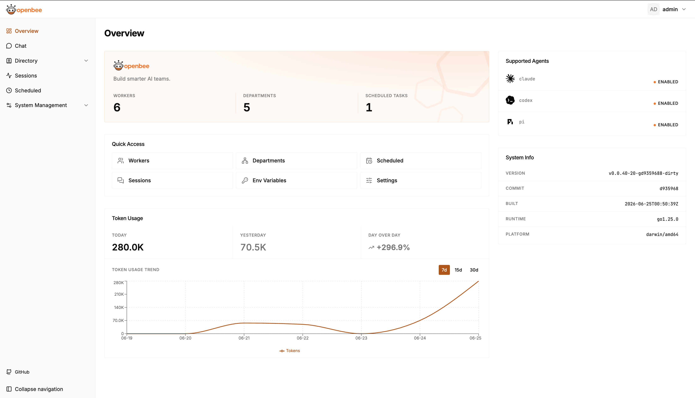

# OpenBee — Build smarter AI teams.

**OpenBee** is an around-the-clock digital worker solution, dedicated to making AI Agents your 7×24 always-on assistant.

To learn more about the project, visit [docs.theopenbee.com](https://docs.theopenbee.com).

[](https://www.npmjs.com/package/@theopenbee/cli)
[](https://www.npmjs.com/package/@theopenbee/cli)
[](LICENSE)
[](https://github.com/theopenbee/openbee/releases)
[](https://github.com/theopenbee/openbee)

<sub><a href="README.zh.md">中文</a> &nbsp;·&nbsp; <a href="https://docs.theopenbee.com">📖 Docs</a> &nbsp;·&nbsp; <a href="https://x.com/0xtyz">0xtyz</a></sub>

## 📸 Screenshots



## 🚀 Quick Start

### Step 1: Install

<details open>
<summary>📦 npm (Recommended)</summary>

```bash
npm install -g @theopenbee/cli
```

The platform-specific binary is downloaded automatically. Supports Linux / macOS / Windows (amd64 & arm64).

</details>

<details>
<summary>🔧 One-click Script</summary>

```bash
curl -fsSL https://raw.githubusercontent.com/theopenbee/openbee/main/install.sh | bash
```

</details>

<details>
<summary>🍺 brew (macOS) / scoop (Windows)</summary>

**macOS (Homebrew):**
```bash
brew install theopenbee/tap/openbee
```

**Windows (Scoop):**
```bash
scoop bucket add theopenbee https://github.com/theopenbee/scoop-bucket
scoop install theopenbee/openbee
```

</details>

<details>
<summary>📥 Manual Binary Download</summary>

Visit [GitHub Releases](https://github.com/theopenbee/openbee/releases), download the archive for your platform, extract it, and place the `openbee` executable in your PATH.

</details>

### Step 2: Start the service

```bash
openbee server -d
```

On first start OpenBee writes `~/.openbee/config.yaml` with defaults and random secrets, and keeps its database at `~/.openbee/data/openbee.db`. Edit that file and restart to change the port or other settings, or pass `-c /path/to/config.yaml` to use a different file.

### Step 3: Install an engine

OpenBee does not bundle an AI engine. Engines are plugins that drive a coding CLI, so first install the CLI you want (Claude Code, Codex or pi) and log in to it yourself. Then install its plugin, either with the command line or from the plugin page of the Web Console:

```bash
openbee plugin install claude   # or codex, or pi
openbee plugin list             # the engine shows as ready once the CLI is found
```

A new engine plugin is enabled right away and takes effect without restarting OpenBee. If the CLI is not on `PATH`, set its location with `openbee plugin configure claude --set path=/path/to/claude`. See the [engine plugin protocol](docs/engine-plugin-protocol.md).

### Step 4: Start using

- Open the Web Console (default [http://localhost:8080](http://localhost:8080)) to manage Workers and view task status
- Send messages directly in any configured platform (a channel plugin such as WeChat, Lark, DingTalk, WeCom, Telegram or Linear) to interact with OpenBee

### Channel plugins

Chat platforms are added as plugins without rebuilding OpenBee, and a running OpenBee installs, configures, enables and removes them without restarting:

```bash
openbee plugin search              # browse the plugin catalog and pick plugins to install
openbee plugin configure telegram  # answer the plugin's questions, then enable it
openbee plugin list                # see every plugin and whether it is running
```

`openbee plugin install <id>`, `enable`, `disable`, `restart`, `update` and `remove` cover the rest; `configure --set key=value` works without prompts. Plugins run on Bun or Node.js; if neither is installed, OpenBee downloads Bun into `~/.openbee/runtime`. See the [channel plugin protocol](docs/channel-plugin-protocol.md).

## 🖥️ Desktop app

A native desktop app for macOS, Windows and Linux, built with [MyGo](https://github.com/egoist/mygo). It ships with the OpenBee server built in, so there is nothing else to install.

1. Download the package for your platform from [GitHub Releases](https://github.com/theopenbee/openbee/releases): `openbee-desktop-<version>-darwin-universal.dmg` (or `.zip`) for macOS, `openbee-desktop-<version>-windows-<arch>-setup.exe` for Windows, `openbee-desktop-<version>-linux-<arch>.deb` (or `.tar.gz`) for Linux.
2. Open it. The built-in server starts on `http://localhost:8080` with `~/.openbee/config.yaml`, the same files `openbee server` uses.
3. On the first launch, create the admin account; later launches sign in automatically.

The built-in server runs while the app runs and stops when you quit it. On macOS and Windows, closing the window keeps the app running in the menu bar or tray; on Linux, closing the window quits. If an OpenBee server already answers on that port, the app uses it instead of starting its own. To use a remote server, choose Change Server in the app menu. Server logs go to `~/Library/Logs/OpenBee/server.log` on macOS and to the `logs` folder of the app data directory elsewhere.

Release builds are not code signed yet, so the first launch needs a manual approval:

- **macOS:** right-click the app and choose Open (on macOS 15 and later, use Open Anyway in System Settings > Privacy & Security), or run `xattr -dr com.apple.quarantine /Applications/OpenBee.app`.
- **Windows:** when SmartScreen shows "Windows protected your PC", click More info, then Run anyway.

To build it from source, install `jq` first (Go 1.27 is downloaded automatically):

```bash
make desktop          # current platform with the built-in server, output in desktop/build/
make desktop-all      # macOS, Windows and Linux with the built-in server
make desktop-client   # current platform, client only: connects to a server you run
```

`make desktop` and `make desktop-all` build the web UI first (pnpm), as `openbee server` embeds it.

## 🌟 Star History

<div align="center">

[](https://star-history.com/#theopenbee/openbee&Date)

</div>

## 🤝 Community

- 🐛 **Bug reports / Feature requests** → [GitHub Issues](https://github.com/theopenbee/openbee/issues)
- 🤝 **Contributing** → Please read the [Contributing Guide](CONTRIBUTING.md). You must agree to the [Contributor License Agreement (CLA)](CLA.md) before submitting.

## 📄 License

OpenBee is licensed under the [GNU Affero General Public License v3.0](LICENSE).

Copyright (c) 2026 TENGYONGZHI
