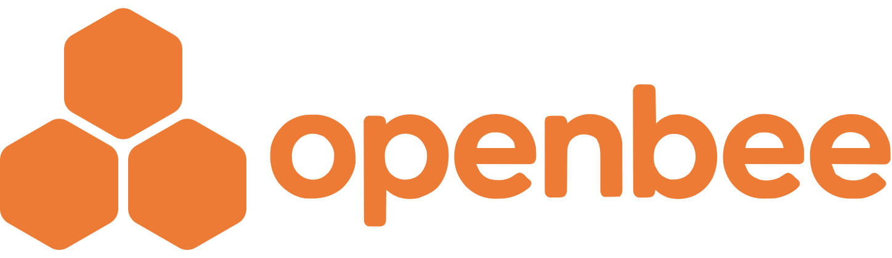
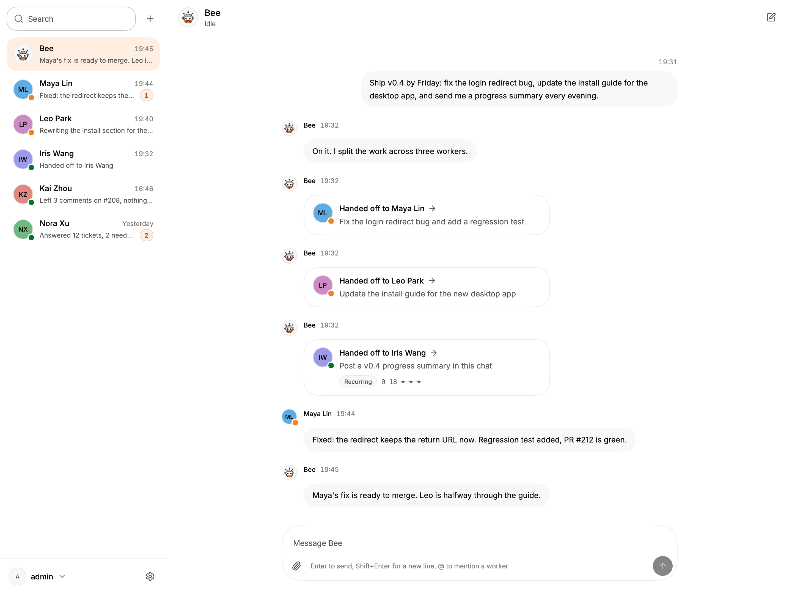

# OpenBee — Build smarter AI teams.

OpenBee turns the agent CLIs you already use — **Claude Code**, **Codex** or **pi** — into a team of always-on workers. Message **Bee**, the coordinator, from the desktop app, the browser or your chat app, and Bee hands the job to the right worker. In a chat app, the result comes back to the same chat. In the desktop app and the browser, each task gets its own worker chat, opened from Bee's handoff card.

[](https://www.npmjs.com/package/@theopenbee/cli)
[](https://www.npmjs.com/package/@theopenbee/cli)
[](LICENSE)
[](https://github.com/theopenbee/openbee/releases)
[](https://github.com/theopenbee/openbee)

<sub><a href="README.zh.md">中文</a> &nbsp;·&nbsp; <a href="https://docs.theopenbee.com">📖 Docs</a> &nbsp;·&nbsp; <a href="https://x.com/0xtyz">0xtyz</a></sub>



## Is it for you?

OpenBee fits if you want to:

- **Delegate by chatting.** Say what you need; a worker does it on your machine. In a chat app it replies in the same chat; in the desktop app and the browser it reports in its own chat.
- **Run several agents at once.** Each worker has its own engine, working folder and rules.
- **Schedule work.** Run tasks now, after a delay, or on a cron schedule.
- **Reach it from anywhere.** Use the desktop app, the web console, or Lark, DingTalk, WeCom, WeChat, Telegram, Discord and Linear.
- **Self-host.** It runs on your computer or server, and your data stays in `~/.openbee`.

**You need** one agent CLI — Claude Code, Codex or pi — installed and signed in. OpenBee drives it and ships no model of its own.

## Quick start

### 🖥️ Desktop app — for your own computer

The server is built in, so this is all you install.

```bash
brew install --cask theopenbee/tap/openbee-desktop             # macOS

scoop bucket add theopenbee https://github.com/theopenbee/scoop-bucket
scoop install theopenbee/openbee-desktop                       # Windows
```

On Linux, or to skip the package manager, download it from [Releases](https://github.com/theopenbee/openbee/releases). Open the app, create the admin account, then install the engine for your CLI under **Settings → Plugins → Marketplace**.

Builds are not code signed yet. If the first launch is blocked, see [First launch](docs/desktop.md#first-launch).

### 🌐 Server — for an always-on machine

```bash
npm install -g @theopenbee/cli
openbee server -d
openbee plugin install claude   # or codex, pi
```

Open <http://localhost:19876> and create the admin account. Other install methods are in [Server and CLI](docs/server.md).

### 💬 Then talk to Bee

> Create a worker named Maya for backend fixes, working in ~/code/api.

Bee creates the worker. Hand it a task the same way. To chat from Lark, Telegram or another app, add a [channel plugin](docs/plugins.md).

## Documentation

- [Desktop app](docs/desktop.md): downloads, first launch, the built-in server, the client-only build, building from source
- [Server and CLI](docs/server.md): install methods, config and data files, everyday commands
- [Plugins](docs/plugins.md): engines and chat channels, from the app or the command line
- [docs.theopenbee.com](https://docs.theopenbee.com): guides for workers, tasks and constraints
- Write a plugin: [channel protocol](docs/channel-plugin-protocol.md), [engine protocol](docs/engine-plugin-protocol.md)

## 🤝 Community

- 🐛 **Bug reports / Feature requests** → [GitHub Issues](https://github.com/theopenbee/openbee/issues)
- 🤝 **Contributing** → Please read the [Contributing Guide](CONTRIBUTING.md). You must agree to the [Contributor License Agreement (CLA)](CLA.md) before submitting.

## 📄 License

OpenBee is licensed under the [GNU Affero General Public License v3.0](LICENSE).

Copyright (c) 2026 TENGYONGZHI
