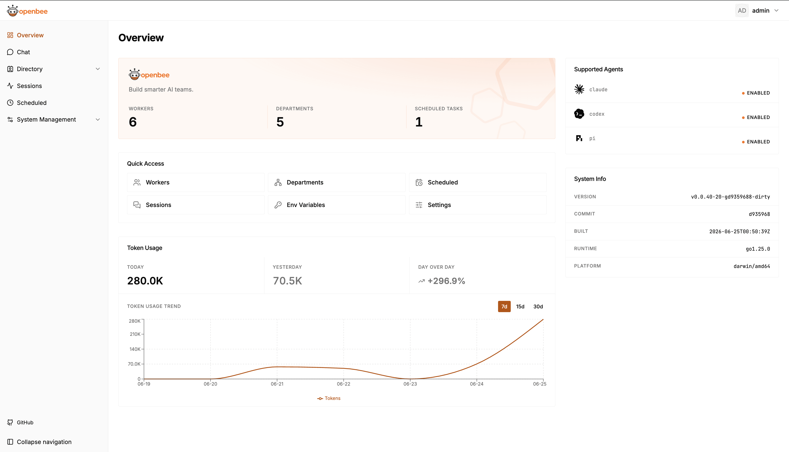

# OpenBee — Build smarter AI teams.

**OpenBee** 是一款全天候的数字员工解决方案，致力于让 AI Agent 成为您 7×24 小时在线的得力助手。

了解更多请访问 [docs.theopenbee.com](https://docs.theopenbee.com)。

[](https://www.npmjs.com/package/@theopenbee/cli)
[](https://www.npmjs.com/package/@theopenbee/cli)
[](LICENSE)
[](https://github.com/theopenbee/openbee/releases)
[](https://github.com/theopenbee/openbee)

<sub><a href="README.md">English</a> &nbsp;·&nbsp; <a href="https://docs.theopenbee.com">📖 文档</a> &nbsp;·&nbsp; <a href="https://x.com/0xtyz">0xtyz</a></sub>

## 📸 产品截图



## 🚀 快速开始

### 第一步：安装

<details open>
<summary>📦 npm（推荐）</summary>

```bash
npm install -g @theopenbee/cli
```

安装时会自动下载当前平台对应的二进制文件，支持 Linux / macOS / Windows（amd64 & arm64）。

</details>

<details>
<summary>🔧 一键安装脚本</summary>

```bash
curl -fsSL https://raw.githubusercontent.com/theopenbee/openbee/main/install.sh | bash
```

</details>

<details>
<summary>🍺 brew（macOS）/ scoop（Windows）</summary>

**macOS（Homebrew）：**
```bash
brew install theopenbee/tap/openbee
```

**Windows（Scoop）：**
```bash
scoop bucket add theopenbee https://github.com/theopenbee/scoop-bucket
scoop install theopenbee/openbee
```

</details>

<details>
<summary>📥 手动下载二进制</summary>

前往 [GitHub Releases](https://github.com/theopenbee/openbee/releases) 页面，下载对应平台的压缩包，解压后将 `openbee` 可执行文件放入 PATH 即可。

</details>

### 第二步：交互式生成配置文件

```bash
openbee config
```

向导将引导你完成以下配置：
- agent 可执行文件路径
- 高级选项（可跳过，使用默认值）

配置文件默认写入当前目录的 `config.yaml`，如需指定路径，使用 `-o` 参数：

```bash
openbee config -o /path/to/config.yaml
```

### 第三步：启动服务

```bash
openbee server -d
```

### 第四步：开始使用

- 打开 Web 控制台（默认 [http://localhost:8080](http://localhost:8080)）管理 Worker 和查看任务状态
- 在已配置的平台（微信、飞书、钉钉、企微、Telegram、Linear 等渠道插件）中直接发送消息，或创建、评论 Linear issue 与 OpenBee 交互

### 渠道插件

聊天平台通过插件接入，无需重新编译 OpenBee；运行中的 OpenBee 安装、配置、启用和卸载插件都不需要重启：

```bash
openbee plugin search              # 浏览插件目录，选择要安装的插件
openbee plugin configure telegram  # 按提示填写插件配置，然后启用
openbee plugin list                # 查看所有插件及其运行状态
```

另有 `openbee plugin install <id>`、`enable`、`disable`、`restart`、`update`、`remove`；`configure --set key=value` 可以不经问答直接配置。插件运行在 Bun 或 Node.js 上；两者都没有时，OpenBee 会把 Bun 下载到 `~/.openbee/runtime`。详见[渠道插件协议](docs/channel-plugin-protocol.md)。

## 🖥️ 桌面版

基于 [MyGo](https://github.com/egoist/mygo) 构建的原生桌面客户端，支持 macOS、Windows 和 Linux，连接你已经运行的 OpenBee 服务。

1. 前往 [GitHub Releases](https://github.com/theopenbee/openbee/releases) 下载对应平台的安装包：macOS 下载 `openbee-desktop-<version>-darwin-universal.dmg`（或 `.zip`），Windows 下载 `openbee-desktop-<version>-windows-<arch>-setup.exe`，Linux 下载 `openbee-desktop-<version>-linux-<arch>.deb`（或 `.tar.gz`）。
2. 打开应用，输入 OpenBee 服务地址（默认 `http://localhost:8080`）。
3. 使用 OpenBee 账号登录。

发布包暂未做代码签名，首次打开需要手动放行：

- **macOS：** 右键点击应用并选择“打开”（macOS 15 及以上请在“系统设置 > 隐私与安全性”中点击“仍要打开”），或运行 `xattr -dr com.apple.quarantine /Applications/OpenBee.app`。
- **Windows：** SmartScreen 提示“Windows 已保护你的电脑”时，点击“更多信息”，再点击“仍要运行”。

从源码构建（会自动下载 Go 1.27）：

```bash
make desktop       # 当前平台，产物在 desktop/build/
make desktop-all   # macOS、Windows 和 Linux
```

## 🌟 Star History

<div align="center">

[](https://star-history.com/#theopenbee/openbee&Date)

</div>

## 🤝 Community

- 🐛 **问题反馈 / 功能建议** → [GitHub Issues](https://github.com/theopenbee/openbee/issues)
- 🤝 **贡献代码** → 请阅读 [贡献指南](CONTRIBUTING.md)，提交前需同意 [贡献者许可协议（CLA）](CLA.md)
