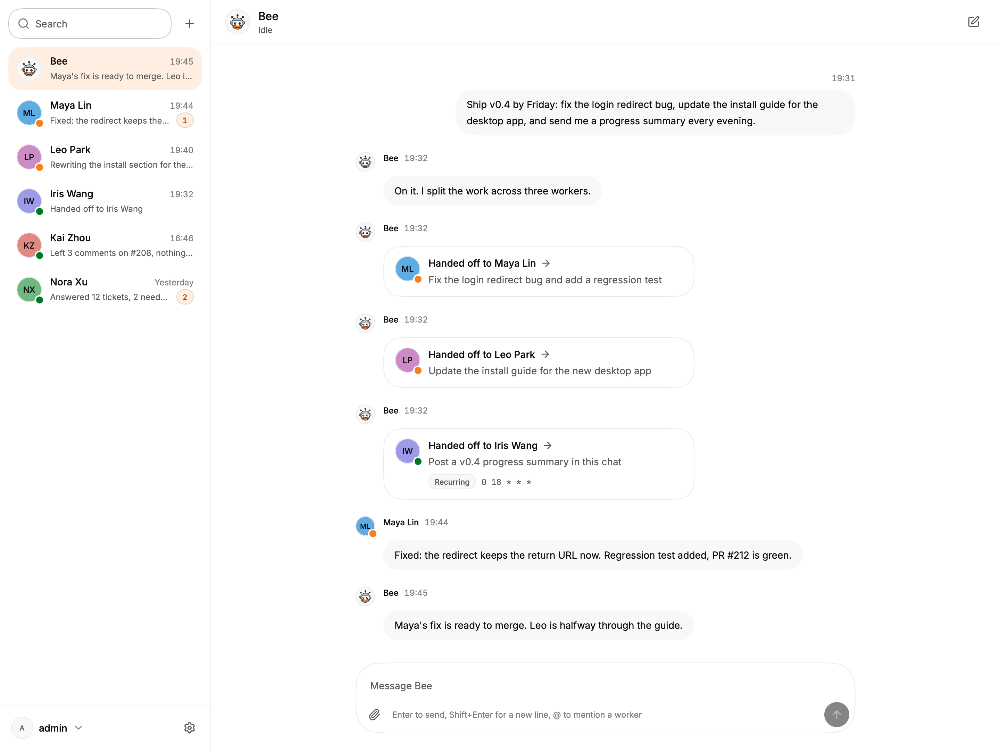

# OpenBee — Build smarter AI teams.

OpenBee 把你已经在用的 Agent CLI —— **Claude Code**、**Codex** 或 **pi** —— 变成一支 7×24 小时在线的数字员工团队。在桌面应用、浏览器或常用的聊天软件里给协调者 **Bee** 发消息，Bee 会把活派给合适的员工，并在同一个对话里把结果带回来。

[](https://www.npmjs.com/package/@theopenbee/cli)
[](https://www.npmjs.com/package/@theopenbee/cli)
[](LICENSE)
[](https://github.com/theopenbee/openbee/releases)
[](https://github.com/theopenbee/openbee)

<sub><a href="README.md">English</a> &nbsp;·&nbsp; <a href="https://docs.theopenbee.com">📖 文档</a> &nbsp;·&nbsp; <a href="https://x.com/0xtyz">0xtyz</a></sub>



## 适合你吗？

如果你想要这些，OpenBee 适合你：

- **聊天就能派活。** 说出需求，员工在你的机器上完成，并在同一个对话里回复。
- **多个 Agent 同时干活。** 每个员工有自己的引擎、工作目录和规则。
- **定时任务。** 任务可以立即执行、延时执行，或按 cron 周期执行。
- **随处可用。** 桌面应用、Web 控制台，或飞书、钉钉、企业微信、微信、Telegram、Discord、Linear。
- **自托管。** 跑在你自己的电脑或服务器上，数据都在 `~/.openbee`。

**前提：** 装好并登录一个 Agent CLI —— Claude Code、Codex 或 pi。OpenBee 负责驱动它，本身不带模型。

## 快速开始

### 🖥️ 桌面版 —— 装在自己的电脑上

内置服务端，装这一个就够了。

```bash
brew install --cask theopenbee/tap/openbee-desktop             # macOS

scoop bucket add theopenbee https://github.com/theopenbee/scoop-bucket
scoop install theopenbee/openbee-desktop                       # Windows
```

Linux 用户，或不想用包管理器，可以从 [Releases](https://github.com/theopenbee/openbee/releases) 下载。打开应用，创建管理员账号，然后在 **设置 → 插件 → 插件市场** 里安装你所用 CLI 对应的引擎。

发布包暂未做代码签名，首次打开被系统拦截时，见[首次打开](docs/desktop.zh.md#首次打开)。

### 🌐 服务端 —— 装在常开的机器上

```bash
npm install -g @theopenbee/cli
openbee server -d
openbee plugin install claude   # 或 codex、pi
```

打开 <http://localhost:19876> 并创建管理员账号。其他安装方式见[服务端与命令行](docs/server.zh.md)。

### 💬 然后，和 Bee 说话

> 帮我建一个员工，叫 Maya，负责后端修复，工作目录是 ~/code/api。

Bee 会创建这个员工。派任务也是一样，直接说。想在飞书、Telegram 等应用里聊天，装一个[渠道插件](docs/plugins.zh.md)即可。

## 文档

- [桌面版](docs/desktop.zh.md)：下载、首次打开、内置服务端、纯客户端版、从源码构建
- [服务端与命令行](docs/server.zh.md)：安装方式、配置与数据文件、常用命令
- [插件](docs/plugins.zh.md)：引擎与聊天渠道，在应用里或用命令行管理
- [docs.theopenbee.com](https://docs.theopenbee.com)：员工、任务与约束的使用指南
- 开发插件：[渠道插件协议](docs/channel-plugin-protocol.md)、[引擎插件协议](docs/engine-plugin-protocol.md)

## 🤝 Community

- 🐛 **问题反馈 / 功能建议** → [GitHub Issues](https://github.com/theopenbee/openbee/issues)
- 🤝 **贡献代码** → 请阅读 [贡献指南](CONTRIBUTING.md)，提交前需同意 [贡献者许可协议（CLA）](CLA.md)

## 📄 License

OpenBee 基于 [GNU Affero 通用公共许可证 v3.0（AGPL-3.0）](LICENSE) 开源。

Copyright (c) 2026 TENGYONGZHI
